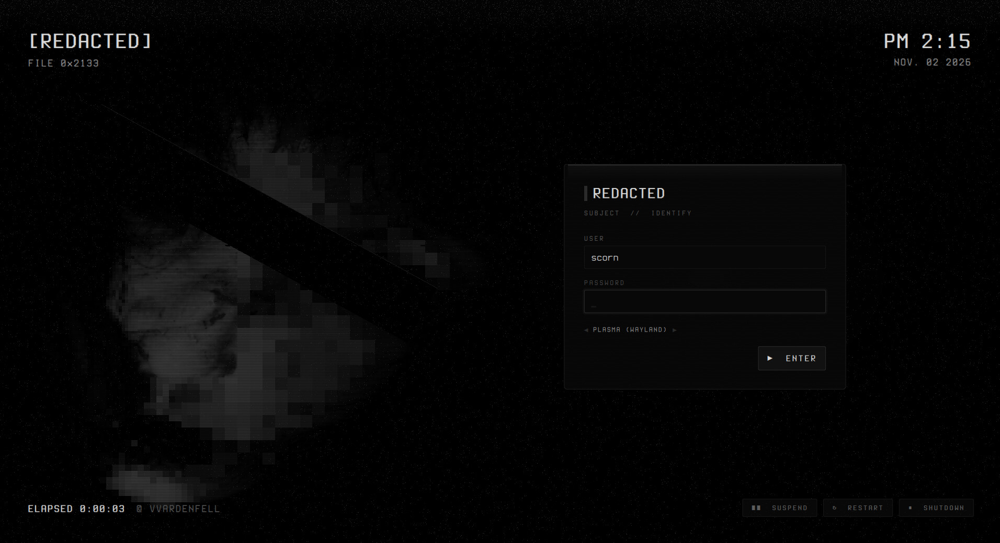
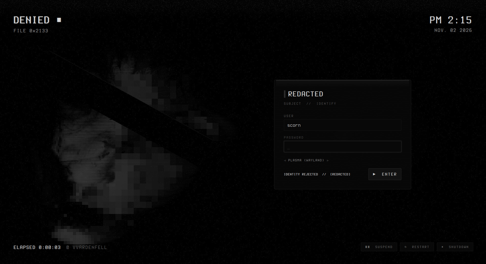

# Redacted — SDDM Login

An SDDM (Qt6) login like a censored file: the face under drifting mosaic and static behind a black panel. A wrong password knocks the censor bar off the eyes.



Redacted is a monochrome-black look for KDE Plasma 6 about obfuscation and censorship. Every colour is a neutral grey, and the accents sit only a few levels above black: almost imperceptible, but just perceptible. The motifs are static, mosaic pixelation, black censor bars and a dissociated double.

## Features

- The animated Redacted scene runs behind the login: drifting mosaic, a censor bar that slips during glitch bursts, a dissociated double, torn rows and rolling static. It is one GPU shader at 12 fps.
- A `[REDACTED]` header with a file number, and the time and date top right.
- A black login panel. The password shows as censor blocks.
- A wrong password flips the header to `DENIED`, knocks the bar off the eyes for a moment and shakes the panel.
- Transport-style power controls.



## Requirements

SDDM with the Qt6 greeter (`sddm-greeter-qt6`) and a GPU with OpenGL. The fonts are bundled.

## Install

```bash
git clone https://github.com/numbpill3d/redacted-sddm
cd redacted-sddm && sudo ./install.sh
```

Or from the KDE Store: Extract it to `/usr/share/sddm/themes/` and pick **Redacted** in System Settings → Colors & Themes → Login Screen (SDDM).

## The rest of the suite

| piece | repo |
|---|---|
| Global theme + splash screen | [redacted-global](https://github.com/numbpill3d/redacted-global) |
| Plasma style (panel, popups) | [redacted-plasma](https://github.com/numbpill3d/redacted-plasma) |
| Aurorae window decoration | [redacted-aurorae](https://github.com/numbpill3d/redacted-aurorae) |
| Colour scheme | [redacted-colors](https://github.com/numbpill3d/redacted-colors) |
| Kvantum widget style | [redacted-kvantum](https://github.com/numbpill3d/redacted-kvantum) |
| Icon theme | [redacted-icons](https://github.com/numbpill3d/redacted-icons) |
| Konsole + kitty colours | [redacted-konsole](https://github.com/numbpill3d/redacted-konsole) |
| Plymouth boot splash | [redacted-plymouth](https://github.com/numbpill3d/redacted-plymouth) |
| Animated wallpaper (desktop + lock) | [redacted-wallpaper](https://github.com/numbpill3d/redacted-wallpaper) |
| Still wallpaper (1080p–4K) | [redacted-image-wallpaper](https://github.com/numbpill3d/redacted-image-wallpaper) |
| KWin open/close effect | [redacted-censor](https://github.com/numbpill3d/redacted-censor) |
| KWin script: active window under review | [redacted-static](https://github.com/numbpill3d/redacted-static) |
| Clock plasmoid | [redacted-clock](https://github.com/numbpill3d/redacted-clock) |

Everything at once, with the generators: [redacted-kde](https://github.com/numbpill3d/redacted-kde).

## Tags

`redacted` `kde` `plasma6` `dark` `black` `monochrome` `grayscale` `minimal` `censored` `glitch` `static` `pixel` `sddm` `sddm-theme` `login-screen` `qt6` `qml` `shader`

## Credits and licence

By splicer scorn (voidrane). GPL-3.0-or-later.
Login font: Terminess Nerd Font (Terminus, SIL OFL 1.1), bundled with its licence.
Shader preamble from Burn-My-Windows by Simon Schneegans (GPL-3.0-or-later).
